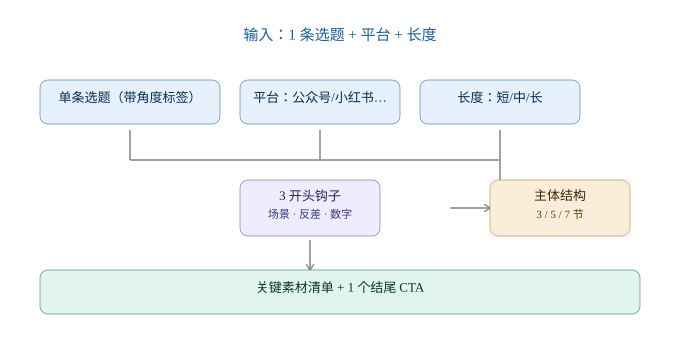
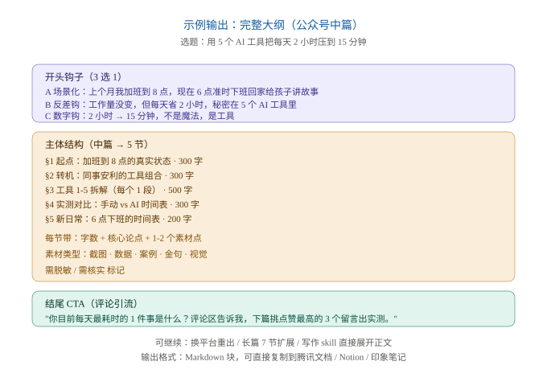

# Viral Outline Generator

> 一条选题 → 完整可写大纲，3 个开头钩子、5 节结构、关键素材、结尾 CTA。

一款 WorkBuddy 技能，专为已经选定选题、准备动笔的创作者设计。接住 [`topic-idea-generator`](https://github.com/YunHaiKong/topic-idea-generator) 的输出，把单条选题展开成"立刻能写"的大纲。



## 效果一览

输入一条选题 + 平台 + 长度，输出标准大纲：



## 为什么需要它

光有选题不够。你还得面对：
- 开头怎么写才能勾住读者？
- 中间怎么分段、铺几个案例？
- 哪里要放截图、哪里要放数据？
- 结尾怎么 CTA 才能引导评论？

这个 skill 一次性把这些结构填好，**省下 60% 的起稿时间**。

## 适用人群

- **公众号作者**：拿到选题直接照大纲写
- **小红书博主**：钩子 3 选 1 + emoji 建议 + 短句结构
- **短视频创作者**：钩子带镜头描述，开头 3 秒就有画面
- **AI 写作者**：把大纲喂给 `content-writer`（计划中）出正文

## 快速开始

### 安装

下载 [`viral-outline-generator.zip`](./viral-outline-generator.zip)（已通过 WorkBuddy 官方校验器）。

```
设置 → 技能管理 → 导入本地 Skill → 选择 zip
```

### 第一次使用

激活后看到这段开场白：

```
你好，我是你的爆款大纲策划。
给我 1 条选题（或者直接说"从上一批选题里挑 #X"），加上目标平台和文章长度，我给你出完整大纲：
- 3 个开头钩子（场景/反差/数字）
- 主体结构（按长度自动给 3/5/7 节）
- 关键素材清单
- 1 个结尾 CTA

不告诉我长度也行，我按公众号中篇默认。
```

## 长度自适应

| 文章长度 | 主体节数 | 适配场景 |
|---|---|---|
| 短（<800 字） | 3 节 | 小红书图文、短笔记 |
| 中（800-2000 字） | 5 节 | 公众号标准文章（默认） |
| 长（2000+ 字） | 7 节 | 深度长文、知乎回答 |

## 输入示例

| 项 | 值 |
|---|---|
| 选题 | 我用 5 个 AI 工具把每天 2 小时压到 15 分钟 |
| 平台 | 公众号 |
| 受众 | 25-35 职场人，想提升效率 |
| 长度 | 中篇（默认） |

## 输出示例（节选）

```markdown
# 我用 5 个 AI 工具，把每天 2 小时重复工作压到 15 分钟

## 开头钩子（任选 1）
### A 场景化
上个月我还在每天加班到 8 点，现在 6 点准时下班回家给孩子讲睡前故事…（80 字）

### B 反差钩
工作量没变、KPI 没变、就我这个人没变。但我从每天加班 2 小时变成 6 点准点下班…（80 字）

### C 数字钩
2 小时 → 15 分钟，这不是魔法，是 5 个 AI 工具干掉的…（80 字）

## 主体结构（中篇 → 5 节）
### §1 起点：加班到 8 点的真实状态 · 300 字
### §2 转机：同事安利的工具组合 · 300 字
### §3 工具 1-5 拆解 · 500 字
### §4 实测对比：手动 vs AI · 300 字
### §5 新日常 · 200 字

## 关键素材清单
- [截图] 5 个工具界面（脱敏）
- [数据] 时间对比表
- [案例] 同事对话截图
- [金句] "工具不是偷懒"
- [视觉] 信息图一张

## 结尾 CTA（评论引流）
你目前每天最耗时的 1 件事是什么？评论区告诉我…
```

完整 demo 见 [`assets/demo-report.md`](./assets/demo-report.md)。

## 5 类素材清单

大纲列出的素材点都从这 5 类里挑：

| 类型 | 用途 | 标记 |
|---|---|---|
| 截图 | 工具界面 / 对比表 | 需脱敏 |
| 数据 | 行业报告 / 统计 | 需核实来源 |
| 案例 | 真实人物 / 公司 | 需脱敏 |
| 金句 | 可单独引用的短句 | — |
| 视觉 | 信息图 / 封面大字 | — |

## 5 种结尾 CTA

按目的自动匹配：

| 目的 | 模板 |
|---|---|
| 评论引流 | "你目前 X 是怎么做的？评论区聊聊" |
| 下篇预告 | "下篇我会拆 X，评论区扣 1 我安排" |
| 私域引流 | "完整版在评论区置顶" |
| 行动召唤 | "今天就试一下 X，回来告诉我效果" |
| 价值观升华 | "X 不是 Y，而是 Z" |

## 与上游 skill 串联

```
topic-idea-generator  →  30 选题表
        ↓ 挑 1 条
viral-outline-generator (本 skill)  →  完整大纲
        ↓ 展开
content-writer (计划中)  →  正文
```

上游仓库：https://github.com/YunHaiKong/topic-idea-generator

## 常见追问

- "第 3 节再展开" → 输出该节完整段落
- "公众号版改成小红书版" → 按平台规则重渲染
- "钩子再爆一点" → 3 个更激进风格的备选
- "整篇写出来" → 交给写作 skill，不在本 skill 范围

## 文件结构

```
viral-outline-generator/
├── SKILL.md                                # 主入口
├── references/
│   └── outline-rules.md                    # 钩子/结构/素材/CTA 规则（运行时加载）
├── assets/
│   ├── workflow.svg                        # 工作流图
│   ├── sample-output.svg                   # 输出示例图
│   └── demo-report.md                      # 完整 demo 复盘
└── viral-outline-generator.zip             # 可分发包
```

## License

MIT
